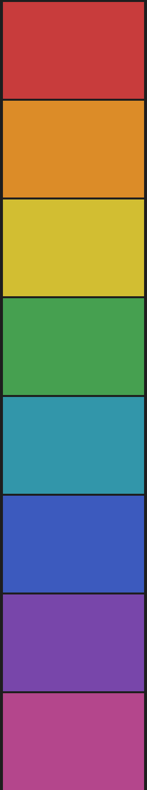

# A tall image

The picture below is 300 by 1600 pixels, a tall image like a screenshot or an infographic. It is shown stacked above the text, scaled down so that it is never taller than 30 times the text size (540 pixels at the default size), with its shape kept.

The first line of text after a tall image opens the same paragraph, the way many posts do. It should be on the first screen, not pushed off it by the picture.

A second paragraph follows, so the page has some body after the image to read.
